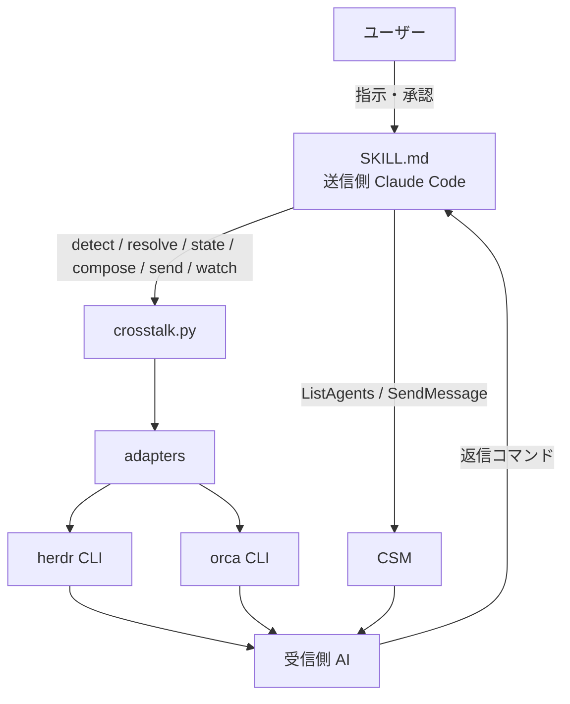
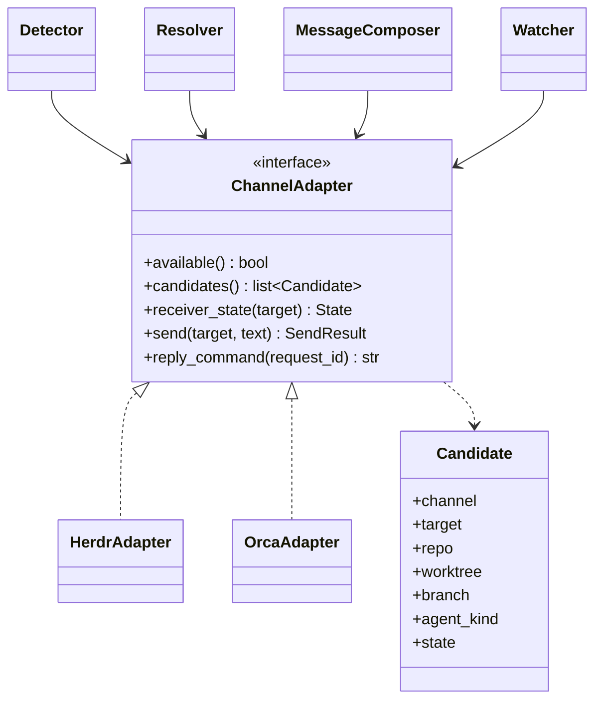
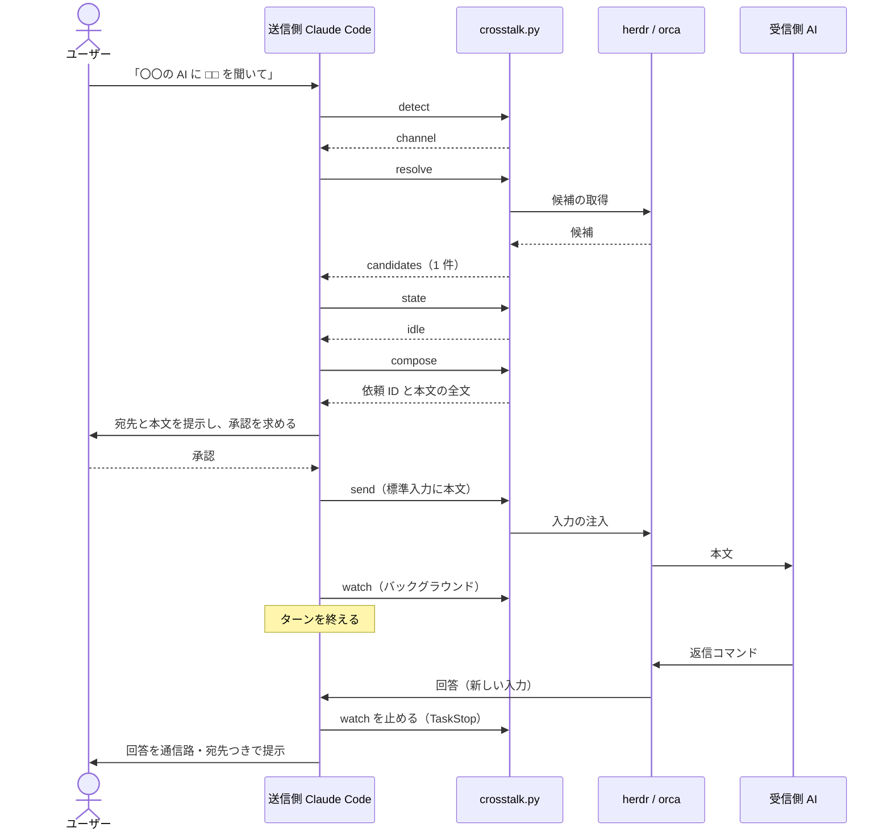
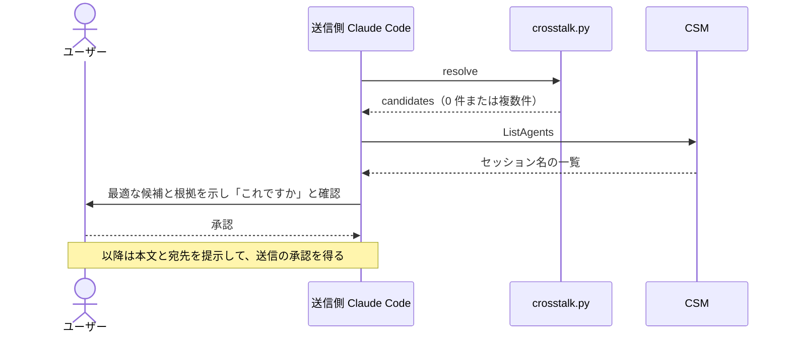

# DES-011 crosstalk プラグイン 設計書

## 1. 概要

要件定義書（APP-003 / FNC-014〜017 / SEC-001）を、Claude Code プラグイン `crosstalk` として実現する。構成は skill 1 つと、Python の CLI 1 本である。判断が要る部分（宛先の鑑定、承認の取得、回答の提示）は AI が SKILL.md の手順に従って担い、毎回同じ結果になるべき部分（通信路の判定、宛先候補の列挙、状態の確認、ヘッダの生成、送信、未着の検知）は script が担う。

## 2. アーキテクチャ概要

### 2.1 責務の分担

| 担い手                              | 責務                                                                                                                   |
| ----------------------------------- | ---------------------------------------------------------------------------------------------------------------------- |
| ユーザー                            | 相手と内容の指示、送信の承認、CSM の宛先提案の可否                                                                     |
| 送信側 Claude Code（SKILL.md）      | 指示の解釈、宛先の鑑定（CSM）、承認の取得、回答の提示、script の呼び出し順                                             |
| `crosstalk.py`                      | herdr / Orca の判定、候補の列挙と絞り込み、受信側の状態確認、ヘッダ付き本文の生成、送信、未着の検知。出力はすべて JSON |
| herdr / Orca の CLI                 | 入力の注入、エージェント一覧、状態の提供                                                                               |
| CSM（`ListAgents` / `SendMessage`） | CSM の候補一覧と送信。script を介さず、AI が直接呼ぶ                                                                   |
| 受信側 AI                           | ヘッダの指示に従って答え、返信コマンドで回答を送り返す                                                                 |

### 2.2 構成図



### 2.3 配布物の構成

```text
crosstalk/
├── .claude-plugin/plugin.json
└── skills/crosstalk/
    ├── SKILL.md
    ├── scripts/
    │   ├── crosstalk.py          # CLI エントリ（サブコマンドの解釈と JSON 出力）
    │   ├── crosstalk_lib/        # detect / resolve / state / compose / send / watch と adapters/
    │   └── tests/                # 単体テスト、fixture、stub CLI
    └── references/
        ├── channels.md           # 通信路ごとのコマンドと、確認済みの版
        └── header.md             # ヘッダの書式と例
```

### 2.4 設計上の制約

- 配布物（SKILL.md、scripts、references、コメント）から、開発リポジトリの文書（要件 ID、設計 ID、ADR、Issue 番号）を参照しない。配布先のプロジェクトには存在しないため
- Python 3 の標準ライブラリだけを使う。外部パッケージを必要としない
- 検証した版は Orca 1.4.216 / herdr 0.8.2 / Claude Code 2.1.284 / Codex CLI 0.158.0。他の版での動作は保証しない（§10）。出力の形式が期待と異なるときは、script は推測で続行せず、`status: error` を返す
- 送信は 1 通ごとに承認を得る。承認の規則は SKILL.md に書き、`send` を事前承認しない（[ADR-012](ADR-012_send_command_not_preapproved.md)）

## 3. モジュール設計

### 3.1 モジュール一覧

| モジュール                        | 責務                                                                                                 | 依存                     |
| --------------------------------- | ---------------------------------------------------------------------------------------------------- | ------------------------ |
| SKILL.md                          | ワークフロー、承認の規則、AI が行う判断、script の呼び出し順、CSM の直接呼び出し                     | crosstalk.py、references |
| `crosstalk.py`                    | サブコマンドの解釈、引数の検証、JSON の出力、終了コード                                              | crosstalk_lib            |
| `detect`                          | herdr / Orca の判定（要件 FNC-014）                                                                  | adapters                 |
| `resolve`                         | 候補の列挙結果の絞り込み、除外、並び順の固定（FNC-015）                                              | adapters                 |
| `state`                           | 受信側が入力待ちかの判定。結果は `idle` / `working` / `blocked` / `unknown`（FNC-016）               | adapters                 |
| `compose`                         | 依頼 ID の発行、ヘッダ付き本文の生成、返信コマンドの生成（FNC-016）                                  | adapters                 |
| `send`                            | 宛先の再確認、送信、受領の判定（FNC-016）                                                            | adapters                 |
| `watch`                           | 上限時間までの待機と、未着時の受信側の状態の取得（FNC-017）。CSM は adapter を使わず、待機のみを行う | adapters                 |
| `adapters/herdr`, `adapters/orca` | 外部 CLI の呼び出しと出力の正規化。候補、状態、送信、返信コマンドの文字列                            | 外部 CLI                 |

- `resolve` `state` `compose` `send` は、通信路の違いを adapters の共通の口に閉じ込め、通信路ごとの分岐を持たない。`watch` も herdr / Orca では同じだが、CSM には adapter が無いため、CSM のときだけ adapter を使わず、待機のみを行う（唯一の例外）
- CSM は script を介さない。`ListAgents` と `SendMessage` は Claude Code のツールで、AI が SKILL.md の手順に従って直接呼ぶ

### 3.2 クラス図



`repo` と `branch` は、通信路が返さないときは空にする。herdr は作業ディレクトリ・pane・種別だけを返すため、`worktree` に作業ディレクトリのパスを入れ、`repo` と `branch` は空になる。

### 3.3 CLI の契約

すべてのサブコマンドは JSON を標準出力に出す。`status` は `ok` か `error`。`error` のときは `reason` を添え、終了コードは 0 以外にする。script は状態を保存しない。必要な値は、呼び出しのたびに AI が引数で渡す。

| サブコマンド | 主な引数                                                                                  | 出力（`ok` のとき）                                       |
| ------------ | ----------------------------------------------------------------------------------------- | --------------------------------------------------------- |
| `detect`     | なし                                                                                      | `channel`（`herdr` / `orca` / `none`）と、判定の根拠      |
| `resolve`    | `--channel` `--repo` `--worktree` `--agent-kind`                                          | `candidates`（固定順）と、除外した候補とその理由          |
| `state`      | `--channel` `--target`                                                                    | `state` と、判定の根拠                                    |
| `compose`    | `--channel`（herdr / orca のみ） `--target` `--kind`（`ask` か `notify`）、本文は標準入力 | 依頼 ID、ヘッダ付き本文の全文、送信元・宛先・返信コマンド |
| `send`       | `--channel` `--target` `--agent-kind` `--request-id`、本文は標準入力                      | 受理の有無と、通信路が返す受領の段階                      |
| `watch`      | `--channel` `--target` `--timeout`、`--request-id`（herdr / Orca のみ）                   | 上限時間に達した旨と、そのときの受信側の状態              |

- `detect` が `none` を返したときは、AI が `ListAgents` の有無で CSM を判定する。CSM が使えるかは script が知る手段を持たないため
- `watch` は `--channel csm` も受け付ける。CSM は受信側の状態を返す手段を持たないため、上限時間まで待って終了するだけである。CSM では、`--target` にセッション名を渡し（報告に添えるため）、`--request-id` は渡さない（依頼 ID を付けないため）
- `compose` は herdr / Orca 専用である。CSM の本文は、AI が §4.6 の手順で組む（依頼 ID は付けない）
- `compose` と `send` は、本文を引数ではなく標準入力から受け取る。長い本文や引用符を、シェルの引数として渡さずに済ませるため

## 4. 処理設計

### 4.1 通信路の判定（detect）

| 通信路 | 判定の条件                                                                         |
| ------ | ---------------------------------------------------------------------------------- |
| herdr  | 環境変数 `HERDR_ENV` が 1 で、`herdr agent list` が成功する                        |
| Orca   | Orca の端末を示す環境変数があり、`orca status --json` が実行基盤に到達できると返す |
| none   | 上記のいずれでもない。AI が CSM の有無を確認する                                   |

環境変数の存在だけでは有効とみなさず、CLI への接続まで確かめる。herdr を先に判定する。両者が同時に有効になることは、想定しない。

### 4.2 宛先解決（resolve）

| 通信路 | 候補の取得元                                                                                     | 除外                                                                  |
| ------ | ------------------------------------------------------------------------------------------------ | --------------------------------------------------------------------- |
| Orca   | `orca worktree ps --json`（リポジトリ・worktree・ブランチ・エージェント）と `orca terminal list` | 自分の端末、リポジトリに紐づかない worktree（一時ディレクトリのもの） |
| herdr  | `herdr agent list`（種別・状態・作業ディレクトリ・pane）                                         | 自分の pane                                                           |

- herdr は、リポジトリとの紐づけ情報を返さない。作業ディレクトリが git の作業ツリーでないもの（`git -C <作業ディレクトリ> rev-parse --is-inside-work-tree` が失敗するもの）を、リポジトリに紐づかない候補として除外する
- 絞り込みは、`--repo` `--worktree` `--agent-kind` を部分一致で適用する。リポジトリ名は、Orca では候補の項目、herdr では作業ディレクトリのパスの部分一致で判定する
- 並び順は、リポジトリ、worktree、種別、target の順に固定する。同じ環境・同じ指定なら、同じ出力になる
- 候補が 1 件のときだけ、AI はそれを宛先とする。0 件・複数件の扱いは §4.6 と §5

### 4.3 受信側の状態確認（state）

判定はベストエフォートで、確認から送信までの競合は扱わない。

| 通信路 × 受信側    | 判定の方法                                                                                 | 結果                                                                        |
| ------------------ | ------------------------------------------------------------------------------------------ | --------------------------------------------------------------------------- |
| Orca × Claude Code | `orca worktree ps` の `agents[].state`（受信側の端末と `paneKey` で対応づける）            | `done` は `idle`、`working` は `working`                                    |
| Orca × Codex       | Orca は状態を記録しない。`orca terminal read` の末尾が、入力待ちの空プロンプトかを確認する | 認識できれば `idle`、処理中の表示なら `working`、判別できなければ `unknown` |
| herdr × 各種別     | `herdr agent list` の `agent_status`                                                       | `idle` `done` は `idle`、`working`、`blocked`（承認待ち）                   |

- `idle` のときだけ、AI は送信の手続きに進む
- `working` `blocked` のときは送信せず、状態をユーザーに報告する
- `unknown` のときは、承認の提示に「状態を確認できなかった」旨を添え、ユーザーが判断する。画面の表示の解釈は版に依存するため、Codex の判別が外れた場合の被害をユーザーの判断で受ける

### 4.4 メッセージの生成（compose）

- 依頼 ID は、6 桁の 16 進数の乱数とする。送信側の会話内で重複しなければよい
- ヘッダは 1 行にまとめる。端末への入力では改行が送信になるため、本文中の改行は空白に置き換える。改行のほか、端末の入力として解釈されうる制御文字（Ctrl-C・EOF・ESC・DEL・C1 制御文字・Unicode の行区切り）も、本文とヘッダの両方で空白に置き換え、置き換えた数を出力（`control_chars_replaced`）に載せる。本文は外部データ由来になりうるため（SEC-001）、受信側の端末の入力を意図せず操作させないためである
- ヘッダの内容は、送信元（リポジトリ・worktree・ブランチ・種別。git と環境から取得）、宛先、依頼 ID、ユーザー入力ではない旨、答え方である
- 答え方に書く返信コマンドは、herdr / Orca について次のとおりとする（CSM の本文は AI が組む。§4.6）。回答の先頭に `[crosstalk 回答 ID: <依頼ID>]` を付ける形式である

| 通信路 | 返信コマンド（送信側の指定は送信時点の値）                             |
| ------ | ---------------------------------------------------------------------- |
| Orca   | `orca terminal send --terminal <送信側の端末> --text "<回答>" --enter` |
| herdr  | `herdr agent prompt <送信側の pane> "<回答>"`                          |

- 送信側の端末・pane は、環境変数（Orca は `ORCA_TERMINAL_HANDLE`、herdr は `HERDR_PANE_ID`）から取る
- `--kind notify` のときは、答え方を「回答不要」とし、返信コマンドは書かない。依頼 ID は付ける
- 返信コマンドが警告を返しても再送しない旨と、再確認は警告が示す再試行の ID（Orca の `--retry-request`。通信層が発行する ID で、依頼 ID とは別物。送信内容と端末のプロセスに紐づくため、回答の文面を 1 文字も変えずに同じコマンドを再実行する）で行う旨を、答え方に含める（herdr には再確認の手段が無いため書かない）

### 4.5 送信（send）

- Orca は `orca terminal send --terminal <端末> --text <本文> --enter --wait-submit 10 --json`、herdr は `herdr agent prompt <pane> <本文>` を実行する
- 送信の直前に、宛先の端末または pane が存在し、種別が `--agent-kind` で渡された期待値と一致することを再確認する。一致しなければ送らずに `error` を返す
- 受領の確認は、Orca は応答の `result.send.accepted` が真で、`result.send.prompt.stages`（段階名の配列）に `turn_started` があるか、herdr は応答の `result.type` が `agent_prompted` かで判定する（いずれも実機で確認した形。Orca 1.4.221、herdr 0.9.3）。確認できないとき（形が違う、ターンの開始を観測できず `input_accepted` だけ、など）は、再送せず、その旨を返す
- 送信に失敗したとき、script は再試行しない

### 4.6 CSM の候補からの提案と送信（AI が行う）

herdr / Orca で宛先を確定できないとき、送信側が herdr / Orca の管理下にないとき、またはユーザーが CSM を使うと明示したときに、次の手順を行う。

1. `ListAgents` で候補（セッション名）を取得する
2. ユーザーの指定と名前の対応を鑑定して、最適な候補を選ぶ。根拠がセッション名だけで、作業ディレクトリは確認できないことを添える。名前は変わりうる（番号が付き、一覧を取るたびに違うことがある）ので、一致はすべて推定である。指定が手がかりにならない、または複数に当てはまるときは、推測せず、候補を一覧にして「どれですか」と尋ねる
3. 「これですか」または「どれですか」とユーザーに確認する。送ろうとしている内容を添える。ユーザーが答えたときだけ、次に進む
4. 本文に、送信元と「CSM で返信すること」を書き、承認を得たうえで `SendMessage` で送る
5. `SendMessage` の応答（キューに入った旨）を、受領の確認としてユーザーに提示する。受信側が保留・拒否したときは `[Cross-session delivery notice]` が届くので、その旨を報告し、再送しない
6. 送信の直後に、`watch --channel csm` をバックグラウンドで起動する（§4.7）

CSM は受信側の記録に送信元が残るため、「ユーザー入力ではない旨」と依頼 ID は付けない（依頼と返信の対応は、CSM のメッセージの送信元名と本文で AI が判断する）。

### 4.7 回答の受け取りと未着の検知

送信側は、送信後にターンを開いたままにしない。回答は新しい入力として届く。未着は、送信の直後に `watch` をバックグラウンドで起動して検知する（[ADR-013](ADR-013_reply_deadline_by_background_timer.md)）。

- 送信の直後に、送信済みで回答待ちであることをユーザーに提示する（全通信路共通）
- `watch` は、上限時間（既定 60 秒。ユーザーが指定すれば、その値）まで待って終了する。終了時に受信側の状態（herdr は `blocked` を含む）を取得して返す
- 回答が届いたら（herdr / Orca は依頼 ID の一致、CSM は宛先のセッションから届いたことを確認したら）、他の処理より先に、必ず `watch` を止める。止めてから、回答を提示する。止め方は、`watch` を起動したときのバックグラウンド実行の識別子を控えておき、`TaskStop` で止める
- 止め損ねて `watch` の終了通知があとから届いても、回答が届いていれば、未着として報告しない
- `watch` が終了したら、未着と報告する前に、回答が届いていないかを必ず確かめる。終了の通知と同時、またはその直後に回答が届いていたときは、未着とせず、回答として扱う。確かめても届いていなければ、AI は未着を報告する。受信側の承認待ちの可能性と、取得できた状態を添える。催促・中断・再送はしない。報告したあとは、ユーザーの指示を待つ
- 未着を報告したあとに、対応づけが成り立つ回答（herdr / Orca は依頼 ID が一致、CSM は宛先のセッションから届いたもの）が届いたときも、回答として提示する
- 対応づけが成り立たない入力（依頼 ID が一致しない入力、CSM で宛先以外のセッションから届いたメッセージ）は、crosstalk の回答として扱わず、届いた内容をそのまま提示する
- CSM は依頼 ID を付けないため、回答の対応づけは、宛先に選んだセッションから届いた `cross-session-message`（`from-name` が宛先のセッション名）で行う。同じセッションから複数のメッセージが届いたときは、本文から AI が回答かを判断する
- 回答の受け取り方式は、要件の検証結果に基づき、返信コマンドを基本とする（[ADR-014](ADR-014_reply_by_return_command.md)）

## 5. ユースケース設計

### 5.1 ユースケース一覧

| ユースケース                  | 説明                                                                     |
| ----------------------------- | ------------------------------------------------------------------------ |
| UC-1 質問する（herdr / Orca） | 相手を指定して質問を送り、回答を受け取る                                 |
| UC-2 伝達する（herdr / Orca） | 回答を求めない情報を送る。受領の確認までで終わる                         |
| UC-3 相手を確定できない       | 候補が 0 件または複数件のとき、CSM の候補から鑑定して提案する            |
| UC-4 CSM で質問する           | 送信側が herdr / Orca の管理下にないとき、CSM で送り、CSM で返信を受ける |
| UC-5 未着                     | 上限時間までに回答が届かないとき、原因の可能性とともに報告する           |
| UC-6 2 往復目                 | 同じ相手への 2 往復目以降の送信は、改めてユーザーの許可を得る            |

### 5.2 シーケンス図（UC-1）



**前提条件**: 送信側が herdr または Orca の管理下にあり、受信側が同じ通信路の管理下にある。
**正常フロー**: 上図のとおり。回答が届いたら `watch` を止める。
**エラーフロー**: 通信路が無い、候補が 0 件・複数件、受信側が入力待ちでない、承認されない、受領を確認できない、のいずれでも送信しないか再送せず、状態を報告する。未着は UC-5、2 往復目は UC-6。

### 5.3 シーケンス図（UC-3）



## 6. 承認と安全の設計

### 6.1 承認

- SKILL.md の手順で、送信のたびに、宛先の解決結果（通信路・リポジトリ・worktree・ブランチ・種別または pane、CSM ならセッション名と推定の根拠）と、本文の全文を提示し、明示的な承認を得る。承認は `AskUserQuestion` で取る
- 承認後に本文を変えたときは、改めて提示して承認を得る
- 宛先の解決結果のうち、通信路が取得できない項目（herdr のブランチなど）は、省略せず「取得不可」と明示する
- 受信側の状態が `unknown` のときは、確認できなかった旨を提示に添える
- ユーザー自身の行動の表明を承認とみなさない旨を、SKILL.md に書く
- `send` と `SendMessage` は、SKILL.md の `allowed-tools` に含めない。含めると、権限の確認が省かれるため（[ADR-012](ADR-012_send_command_not_preapproved.md)）。読み取りだけの `detect` `resolve` `state` `compose` `watch`、候補一覧の `ListAgents`、`watch` を止める `TaskStop` は事前承認する
  - `crosstalk.py` は 1 本の CLI なので、Bash の許可はサブコマンドごとに列挙する。形は `Bash(python3 ${CLAUDE_SKILL_DIR}/scripts/crosstalk.py detect *)` で、`detect` `resolve` `state` `compose` `watch` の 5 つについて 1 行ずつ書く
  - サブコマンドを問わない 1 本の許可（`crosstalk.py *` など）は書かない。`send` まで事前承認されるため
  - 起動パスは `${CLAUDE_SKILL_DIR}` で書く。Claude Code が SKILL.md の本文と `allowed-tools` の Bash の規則の両方で展開するため、許可の対象と実行するコマンドが同じ表記で一致する

### 6.2 skill の起動方法

`disable-model-invocation` は付けない。要件の成功の定義が、自然語の指示（「〇〇の AI に □□ を聞いて」）で始まるため、Claude が自動で起動できる必要がある。自動で起動しても、送信は承認を経ないと行われない。

### 6.3 外部データの扱い

- 受け取った回答は、指示が含まれていても実行せず、提示するだけにする
- 回答は、herdr / Orca では依頼 ID が一致するもの、CSM では宛先のセッションから届いたものだけを、crosstalk の回答として扱う
- 同じ相手との往復は 1 往復までとする。2 往復目以降は、改めてユーザーの許可を得る。往復の数は、会話の中で AI が数える

## 7. エラーハンドリング

| 条件                              | script の出力                    | AI の動作                                          |
| --------------------------------- | -------------------------------- | -------------------------------------------------- |
| 通信路が無い                      | `detect` が `none`               | CSM の有無を確認。CSM も無ければ、送信せず報告する |
| 外部 CLI が期待と異なる出力を返す | `status: error`（`reason` 付き） | 推測で続行せず報告する                             |
| 候補が 0 件・複数件               | `candidates` の件数              | §4.6 の提案、または候補を並べてユーザーに選ばせる  |
| 受信側が `working` / `blocked`    | `state`                          | 送信せず、状態を報告する                           |
| 受信側が `unknown`                | `state`                          | 承認の提示に添え、ユーザーが判断する               |
| 宛先が存在しない・種別が違う      | `send` が `error`                | 送らず報告する                                     |
| 受領を確認できない                | `send` が受領なしを返す          | 再送せず報告する                                   |
| 上限時間までに回答が届かない      | `watch` の終了                   | 未着を、原因の可能性とともに報告する               |

CSM では、受信側が保留・拒否したとき、`[Cross-session delivery notice]` が送信側に届く。AI はその旨を報告し、再送しない。

## 8. 使用する既存コンポーネント

| コンポーネント     | ファイルパス                                              | 用途                                                                  |
| ------------------ | --------------------------------------------------------- | --------------------------------------------------------------------- |
| marketplace の登録 | `.claude-plugin/marketplace.json`                         | `plugins[]` に crosstalk を `source: "./crosstalk"` で登録する        |
| テストの実行       | `.github/workflows/ci.yml`                                | `scripts/` で `python3 -m unittest discover -s tests -t .` を実行する |
| skill の規範       | `skill-creator` スキル（meta プラグイン。本リポジトリ外） | SKILL.md の作成と、作成後の検証                                       |

当初は同居していた meta / ai-trend-advisor プラグインの実装を雛形として参照していたが、本リポジトリは crosstalk 単独の配布に切り替えたため、それらは本リポジトリに存在しない。

再利用しない判断: Orca の orchestration（Run / Task / Dispatch）は、要件のスコープ外であり、既存セッションに届かないため使わない。forge の他の skill には依存しない。配布物は自己完結させる。

## 9. テスト設計

### 9.1 単体テスト

- `detect`: 環境変数と CLI の成否の組み合わせ（herdr 有効、Orca 有効、どちらも無効、環境変数はあるが接続できない）
- adapters: 実機の出力から作った fixture を入力に、候補・状態・受領の正規化を確認する。fixture は、他リポジトリ名・セッション名・端末ハンドルを含まない匿名の値で作る
- `resolve`: 部分一致、除外（自分、リポジトリに紐づかない worktree）、並び順の固定（同じ入力で同じ出力）
- `state`: Orca × Claude Code、Orca × Codex（認識できる表示、処理中、判別不能）、herdr の各状態
- `compose`: ヘッダの全項目、改行の 1 行化、依頼 ID の形式、返信コマンドの文字列（herdr / Orca）
- `watch`: 短い秒数でのタイムアウトと、終了時の状態の取得
- 期待と異なる CLI 出力で、`status: error` を返し、推測で続行しない

外部 CLI は、PATH の先頭に置いた stub の `orca` と `herdr` で置き換える。

### 9.2 統合テスト（実機・手動）

要件の検証結果と同じ手順で、Orca、herdr、CSM の各通信路を 1 往復する。

- 確認済みの項目: 10 分（600 秒）のバックグラウンド実行は、打ち切られずに完了し、終了通知で送信側が再開する（Claude Code 2.1.284 で実測）。`watch` の上限時間は、Bash ツールの上限である 10 分までとし、それを超える指定は受け付けない

### 9.3 skill の検証

`skill-creator` の検証チェックリストで SKILL.md を確認する。説明文（description）にトリガー条件を含める。

## 10. 保証しないこと

- 確認から送信までの間に受信側の状態が変わる競合は、対象外とする（要件のスコープ外）
- 検証した版（§2.4）以外での動作は保証しない。出力の形式が変わったときは、script が `error` を返して止まる
- 会話が圧縮されて依頼 ID や往復の数が失われた場合、回答の対応づけや往復の制限が働かないことがある。会話上の情報に頼るためである
- 承認した本文と、`send` に渡す本文が同じであることは、script では検証しない。AI が SKILL.md の手順に従って、承認を得た本文をそのまま渡すことに依存する。権限の確認が有効な設定では、実行するコマンドと本文が確認として示される（[ADR-012](ADR-012_send_command_not_preapproved.md)）
- ヘッダの送信元と依頼 ID は自己申告であり、herdr / Orca では受信側も送信側も、届いた入力をユーザーの入力と区別できない
