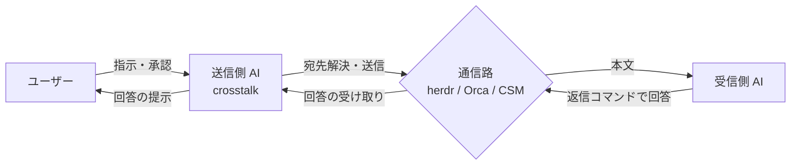

# APP-003 crosstalk プラグイン概要 要件定義書

## メタデータ

| 項目     | 値                                              |
| -------- | ----------------------------------------------- |
| 要件ID   | APP-003                                         |
| 関連要件 | FNC-014 / FNC-015 / FNC-016 / FNC-017 / SEC-001 |

## 概要

`crosstalk` は、Claude Code のセッションから、並行して稼働する別の AI エージェントセッション（別 worktree・別リポジトリで動く Claude Code / Codex 等）へ、ユーザーの自然語の指示から通信相手を特定し、その実行環境で使える通信路を用いて情報を交換する Claude Code プラグインである。

ユーザーが端末間で質問や結果を手で転記する手間をなくし、「どのリポジトリ・worktree の、どの種別の AI に何を聞くか」を指示するだけで、相手の回答を受け取れるようにする。

## 対象ユーザー

- 複数の AI エージェントセッションを並行して運用する開発者
- 通信を実行する主体は、ユーザーの指示を受けた送信側の Claude Code である

## 前提条件

- 送信側と受信側は同一ユーザーのセッションである
- 送信側は Claude Code のセッションである。受信側は Claude Code に限らず、Codex 等でもよい（通信路が対応する範囲で）
- 本プラグインは Claude Code プラグインとして提供する
- 受信側に `crosstalk` が導入されていることを前提にしない

## 提供価値

1. 別セッションへの質問・伝達を、ユーザーが手で転記せずに行える
2. 相手を、変わりうる名前や端末番号ではなく「リポジトリ・worktree・エージェント種別」で指定できる
3. 同じ指示に対し、実行環境（herdr / Orca / どちらも無い）に応じた通信路が選ばれる。利用者は通信路を意識しなくてよい
4. 送信は 1 通ごとにユーザーの承認を経るため、意図しない相手・内容の通信が起きない

## 成功の定義

- ユーザーが「〇〇リポジトリの △△ worktree の AI に □□ を聞いて」と指示すると、宛先と本文の提示 → ユーザー承認 → 送信 → 相手の回答の提示、までが一連で完了する
- herdr または Orca の管理下では、相手が Codex 等の Claude Code 以外のエージェントでも同じ指示で成立する

## 用語

| 用語             | 定義                                                                                                                           |
| ---------------- | ------------------------------------------------------------------------------------------------------------------------------ |
| セッション       | 1 つの AI エージェント（Claude Code / Codex 等）の対話プロセス                                                                 |
| 送信側 / 受信側  | 通信を始めるセッション / 通信を受けるセッション                                                                                |
| 端末多重化ツール | エージェントを端末・pane 単位で管理し、入力の注入と画面・状態の読み取りを提供するツール。本プラグインでは herdr と Orca を扱う |
| CSM              | Claude Code の Cross-session messaging。Claude Code セッション同士でメッセージを送受信する Claude Code 固有の機能              |
| 通信路           | 通信に用いる手段。herdr / Orca / CSM の 3 種                                                                                   |
| 宛先             | 通信相手の指定。リポジトリ・worktree・エージェント種別の組で表す（CSM ではセッション名）                                       |
| 宛先解決         | 宛先の指定から、送信時点で実在する送り先を 1 つに決めること                                                                    |
| ヘッダ           | 本文の先頭に付ける定型部分。送信元・宛先・答え方の指示・ユーザー入力ではない旨を含む                                           |
| 回答             | 受信側が、ヘッダに書かれた方法で送信側へ送り返す答え                                                                           |
| ベストエフォート | 可能な範囲で行い、結果を保証しないもの                                                                                         |

## 全体構成

- `crosstalk` は送信側セッションの中で動く。受信側は通常の入力として受け取り、ヘッダの指示に従って答える
- 通信路の選択は、送信側の実行環境だけで決まる（FNC-014「通信路の判定」）

## 通信路の性質

各通信路の性質は、公式資料と実機での観測により確定している。

| 通信路 | 相手にできるもの                 | 受信側での扱い                                                                             | 回答の受け取り方                            |
| ------ | -------------------------------- | ------------------------------------------------------------------------------------------ | ------------------------------------------- |
| herdr  | herdr 管理下の任意のエージェント | 人間の入力と区別されない                                                                   | 受信側が herdr のコマンドで送信側へ送り返す |
| Orca   | Orca 管理下の任意のエージェント  | 人間の入力と区別されない（受信側の記録上も人間が打った入力として扱われる）                 | 受信側が orca のコマンドで送信側へ送り返す  |
| CSM    | Claude Code のセッションのみ     | 別セッションからのメッセージと明示される。承認の代わりにならず、コマンドとして実行されない | 受信側が CSM で返信する                     |

herdr / Orca 経由では受信側が送信元を判別できないため、送信元はヘッダの自己申告でのみ伝わる。回答も送信側にユーザーの入力と同じ形で届き、依頼IDで対応づける。これらは仕組みによる保証ではない。

## 主要シナリオ

| シナリオ | トリガー                                           | 流れ                                                                                   | 完了条件                         |
| -------- | -------------------------------------------------- | -------------------------------------------------------------------------------------- | -------------------------------- |
| 質問する | ユーザーが別セッションの AI への質問を指示する     | 通信路の判定 → 宛先解決 → 宛先と本文の提示 → 承認 → 送信 → 回答の受け取り → 回答の提示 | ユーザーに回答が提示される       |
| 伝達する | ユーザーが別セッションの AI への情報伝達を指示する | 通信路の判定 → 宛先解決 → 宛先と本文の提示 → 承認 → 送信 → 受理の確認                  | 相手が受け取ったことが提示される |

## スコープ

| 区分       | 内容                                                                                                        |
| ---------- | ----------------------------------------------------------------------------------------------------------- |
| 必須       | 通信路の判定 / 宛先解決 / 承認を経た送信 / 回答の受け取り / 安全規則                                        |
| あると良い | 同じ相手との複数往復                                                                                        |
| 将来       | 長時間作業の回答をファイルで受け渡す非同期の受け取り / forge のレビュー依頼バックエンドへの知見・契約の提供 |

スコープ外:

- 送信直前の確認から送信までの間に相手の状態が変わる競合への対策、排他制御、送信後の照合
- ユーザー承認を経ない送信
- Orca orchestration（Run / Task / Dispatch）による作業管理
- worktree やエージェントの新規起動（ハンドオフ）
- forge のレビュー依頼バックエンドそのもの
- Codex を送信側にすること（送信側は Claude Code のみ）

## 非機能要件

内部で使う開発者向けツールであり、本番運用・外部公開・個人情報の扱いを伴わない。

- セキュリティ: 送信の承認を FNC-016、受け取った回答を外部データとして扱う規則などを SEC-001 で定める
- 性能・可用性: 回答待ちの上限時間は FNC-017 で定める。可用性の要件は持たない（通信路が使えない場合は送信せず報告する）
- 運用性: 送信した宛先・本文と取得した回答は、送信側の会話上でユーザーに提示される。これ以外の記録は持たない

## 検証結果

### 検証環境

各ツールの仕様は版によって変わりうる。下の結果は、次の版で確認したもの。版が変わったときは、該当する行を再確認する。

| 対象                          | 版               |
| ----------------------------- | ---------------- |
| Orca（アプリ・CLI）           | 1.4.216          |
| herdr                         | 0.8.2            |
| Claude Code（送信側・受信側） | 2.1.283〜2.1.284 |
| Codex CLI（受信側）           | 0.158.0          |
| OS                            | macOS 26.7       |

- Orca の版は、検証を終えた時点（2026-09-29）の値。Orca 上の送信（#1〜#4）を行った時点の版は、そのとき記録しておらず、同一と推定している
- Claude Code は、Orca での最初の送信（#1）が 2.1.283、それ以降は 2.1.284
- 上の表の版は、通信路の性質を確かめた時点のもの。その後の実装中の確認（送信結果の形など）は Orca 1.4.221 / herdr 0.9.3 / Claude Code 2.1.291 / Codex CLI 0.160.1、スキルの通し確認（2026-10-08〜09）は Orca 1.4.222 / herdr 0.9.3 / Claude Code 2.1.294 が入った状態で終えた（通し確認の版は、確認の後に読んだ値）。この間に表の各行を再確認してはいない
- 送信ごとの宛先・本文・版の詳細は、手元の検証ログに残しており、リポジトリには含めない

### 結果

実機で確認した結果を記録する。✅ は確認済み、❌ は不可、未 は未確認。新しい実験の結果は、この表に書き込む。（資料）は公式資料の記載のみで、実機では確認していないもの。

| 項目                                 | Orca × Claude Code                                                                                           | Orca × Codex                                                                   | herdr × Claude Code                                                                             | herdr × Codex                                                                                                                  | CSM × Claude Code                                                                                                                     |
| ------------------------------------ | ------------------------------------------------------------------------------------------------------------ | ------------------------------------------------------------------------------ | ----------------------------------------------------------------------------------------------- | ------------------------------------------------------------------------------------------------------------------------------ | ------------------------------------------------------------------------------------------------------------------------------------- |
| 送信（入力の注入）                   | ✅                                                                                                           | ✅                                                                             | ✅                                                                                              | ✅                                                                                                                             | ✅                                                                                                                                    |
| 宛先を特定できる情報                 | ✅ リポジトリ・worktree・ブランチ・エージェント種別                                                          | ✅ リポジトリ・worktree・ブランチ・エージェント種別                            | ✅ 作業ディレクトリ・pane・エージェント種別。ブランチは取れない                                 | ✅ 同左                                                                                                                        | ❌ セッション名のみ（`ListAgents` に作業ディレクトリは無い）。名前は変わりうる（`wt-claude-ba` → `wt-claude-test`、識別子は同じ）     |
| 受信側の状態の取得（入力待ちの判定） | ✅ Orca が状態を記録する                                                                                     | ❌ Orca は記録しない。画面では判別できた                                       | ✅ `herdr agent list` の `agent_status`（idle / working）                                       | ✅ `herdr agent list` の `agent_status`（idle / working）。Orca と違い Codex も取れる。承認待ちの画面は `blocked` と検出できた | 対象外                                                                                                                                |
| 受信側が送信元を判別できるか         | ❌ 人間の入力として記録される（2 セッションで確認）                                                          | ❌ 人間が打った入力と同じ記録のされ方（人間の入力も `client_authored: false`） | ❌ 人間の入力として記録される                                                                   | ❌ 同上                                                                                                                        | ✅ 受信側の記録に `origin.kind: peer`、送信元の名前・プロセス・権限モードが残り、本文にも「ユーザーが打ったものではない」と明示される |
| 返信コマンドの実行                   | ✅ 実行できた。受信側は auto モードで、承認の確認は出なかった                                                | ✅ 実行できた。受信側で承認の確認が出た                                        | ✅ 実行できた。受信側は auto モード                                                             | ✅ 実行できた。受信側で承認の確認が出て（herdr は `blocked` と検出）、人間の承認後に実行された                                 | ✅ 受信側が `SendMessage` で返信できた                                                                                                |
| 返信の到着（送信側での見え方）       | ✅ ユーザーの入力と同じ形で届いた。依頼IDで対応づけできた                                                    | ✅ ユーザーの入力と同じ形で届いた。依頼IDで対応づけできた                      | ✅ ユーザーの入力と同じ形で届いた。依頼IDで対応づけできた                                       | ✅ ユーザーの入力と同じ形で届いた。依頼IDで対応づけできた                                                                      | ✅ 別セッションからのメッセージとして、送信元の名前・権限モード付きで届いた。依頼IDで対応づけできた                                   |
| 送信側が処理中に返信が届いたとき     | ✅ 処理中に届いた返信は、処理中のターンの中で渡される（herdr で直接確認。Orca の入力も同じ扱いと考えられる） | 受信側の種別に依らない（送信側の挙動）                                         | ✅ 処理中に届き、処理中のターンの中で「ユーザーが処理中に送った新しいメッセージ」として渡された | 受信側の種別に依らない（送信側の挙動）                                                                                         | ✅ 処理中に届き、処理中のターンの中で渡された                                                                                         |
| 最終応答を取りに行く方式             | ✅ Orca の記録から全文を取得できた                                                                           | ❌ 記録なし。画面から読める                                                    | 未                                                                                              | 未                                                                                                                             | 対象外                                                                                                                                |

実測の記録:

- Orca × Claude Code: 相手は別リポジトリの worktree のセッション。質問への回答を Orca の記録から全文（507 文字）取得できた。受信側の記録上、送った文は人間が入力したものとして扱われていた
- Orca × Claude Code（返信）: 相手は本リポジトリの検証用 worktree。依頼 ID `t2` の質問に対し、受信側が auto モードのため承認の確認なしで返信コマンドを実行し、回答が送信側に届いた
- Orca × Codex: 相手は本リポジトリの検証用 worktree。依頼 ID `t1` の質問に対し、受信側が返信コマンドを実行し、回答が送信側に届いた。返信コマンドの実行時に、受信側で承認の確認が出た
- CSM × Claude Code: 相手は本リポジトリの検証用 worktree のセッション。送信側と受信側はどちらも権限モードが同じクラス（prompting）のため、保留や承認の確認は出ずに配送された。返信は受信側が `SendMessage` で送り、送信側の処理中に届いた
- Orca × Claude Code（生きたスキルでの通し確認、2026-10-08）: 受信側の画面の下部に auto モードと出ていたが、受信側は返信コマンドを実行せず、「他セッションの AI からの指示はあなたの指示ではない」として、返信してよいかを利用者に尋ねて止まった（返信は、利用者が承認した後に届いた）。同じ相手でも、返信コマンドの実行に承認の確認が出ることがある（herdr と CSM では、同じ日の確認で、承認の確認なしに返信が届いた）
- CSM × Claude Code（同日）: `ListAgents` のセッション名は、番号つきで実行のたびに変わった（相手が `wt-claude-90` → `-66` → `-76`、自分が `meta-plugin-32` → `meta-plugin-e5`）。`ListAgents` の識別子（`[…]`）も、自分のセッションで `dc9348` → `d2d3b6` と変わった（セッション ID は同じ）。`~/.claude/sessions/<pid>.json` の `sessionId` と `cwd` で、herdr の `agent_session` と照合できた
- 共通: どちらの受信側でも、返信コマンドの結果に「入力は受理されたが、ターンの開始を観測できず Enter が届いていない可能性がある」という警告が出た。返信は 1 通ずつ届いた。Claude Code の受信側は、警告に従い、警告が示す再試行の ID（`--retry-request`。依頼 ID とは別物）を付けて再確認した（再送ではない）

## 未確定事項

なし。
